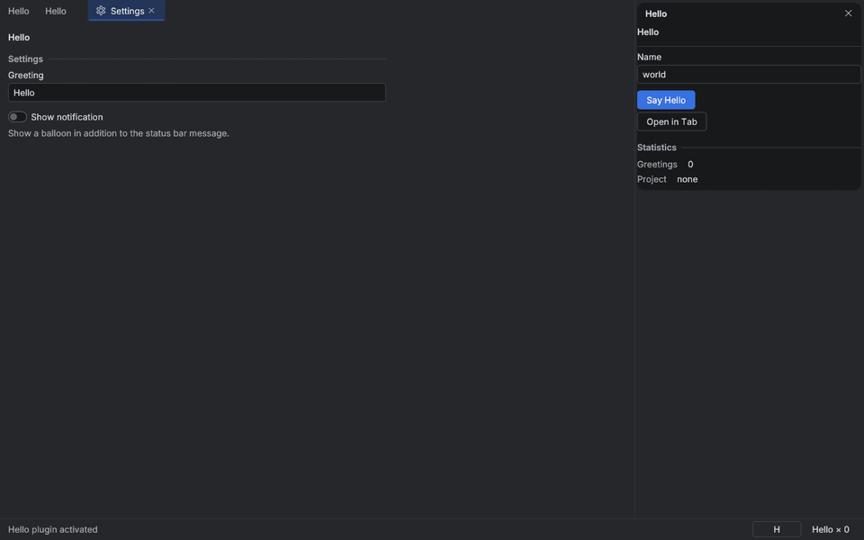

# Standalone apps

Any `Plugin` can run as a desktop app, with no host: `archipel-app` (re-exported as
`archipel_sdk::app`, feature `app`, on by default) opens an eframe window, installs the kit
theme and hosts the plugin. Nexus HTTP and Mongo Raabit use it instead of a hand-written shell.



## Run a plugin

The manifest needs an `[app]` view, the one that fills the window:

```toml
# archipel-plugin.toml
[app]
view = "mytool.main"
title = "My Tool"
```

```rust,ignore
// examples/app.rs (or src/main.rs)
use archipel_sdk::app::{AppError, AppOptions, ThemeMode, run};

fn main() -> Result<(), AppError> {
    let theme = ThemeMode::from_args(std::env::args().skip(1)).unwrap_or_else(|message| {
        eprintln!("{message}");
        std::process::exit(2);
    });
    run(MyTool::new(), AppOptions { theme, ..AppOptions::new("My Tool", "com.example.mytool") })
}
```

[`examples/hello/examples/app.rs`](../examples/hello/examples/app.rs) is the compiled version:
`cargo run -p hello --example app [-- --light | --dark]`.

`AppOptions` (all fields have defaults, `AppOptions::default()` reads everything from the
manifest):

| Field | Default | Meaning |
|---|---|---|
| `title` | manifest `[app] title`, else `name` | window title |
| `id` | plugin id | names the app's directories and the window's app id (Wayland, X11 class) |
| `size`, `min_size` | 1280×800, 760×480 | points |
| `theme` | `ThemeMode::System` | follow the OS dark/light setting, or force `Light` / `Dark` |
| `keybindings` | none | extra `(chord, command)` pairs |
| `dirs_root` | platform directories | keep data, config and cache below one directory (portable installs, tests) |
| `secrets` | `SecretBackend::Auto` | `File` skips the OS keychain |
| `renderer` | `ARCHIPEL_RENDERER`, else wgpu | `Renderer::Wgpu` or `Renderer::Glow` |
| `icon` | platform default | window and taskbar icon; set it from a PNG with `AppOptions::new(..).with_icon_png(include_bytes!("icon-256.png")).expect("bundled icon")` |

## Renderer

The window uses wgpu with the Vulkan, Metal, DX12 and GL backends enabled. (Depending on
eframe's `wgpu` feature alone enables no backend and panics at startup with "no wgpu backend
feature"; this crate enables them.) On a machine without a working Vulkan or GL driver stack for
wgpu, set `ARCHIPEL_RENDERER=glow` to use OpenGL through glow. An unknown value is an error
(`AppError::Renderer`), not a silent fallback.

## What the window does

| Area | Behavior |
|---|---|
| Theme | `archipel_kit::install` once and again when the OS switches dark/light (unless forced) |
| App view | `Plugin::render_view` with `ViewPlacement::App` fills the window |
| Tool windows | side panels (left, right, bottom by `anchor`) drawn in a kit `Panel` with a close button. Toggle them with the buttons in the status bar, the palette (`Toggle <title>`) or `host.open_tool_window(id)` |
| Editor tabs | `host.open_editor_tab(request)` opens a kit `TabBar` tab (same `key` focuses the existing one); the app view stays the first tab. Shown only once a tab is open |
| Settings | **Open Settings** (palette) opens a tab rendered from the plugin's `SettingsPage`s: `Text` → `TextField`, `Bool` → `Toggle`, `Number` → validated `TextField`, `Choice` → `Dropdown` |
| Status bar | `show_status` text on the left; status widgets (`Plugin::status_widget`, clickable when they have a command), the running task and tool window buttons on the right |
| Notifications | `host.notify` shows kit `Toast`s bottom-right; info toasts fade after 5 s, warnings 8 s, errors 12 s |
| Tasks | `begin_task` / `update_task` / `end_task` show a kit `ProgressBar` in the status bar |
| Commands | `host.dispatch` runs after the current call; a failing command becomes an error toast |
| Palette | <kbd>Ctrl+Shift+A</kbd> (<kbd>⇧⌘A</kbd> on macOS: the chord is `Mod+Shift+A`) lists the plugin's commands and the app's own; type to filter, <kbd>↑</kbd><kbd>↓</kbd> <kbd>Enter</kbd> run, <kbd>Esc</kbd> closes |
| Keymap | the plugin's `keybinding`s, then `AppOptions::keybindings`, then the user's `keymap.toml` |

The first frame only paints the window; the plugin is activated on the second, so the window
shows before any setup. If `activate` fails the window shows the error instead of the view.
`deactivate` runs when the window closes.

Built-in command ids start with `app.` and cannot be contributed by plugins in a standalone
app: `app.commandPalette`, `app.settings`, `app.quit` and `app.toolWindow.<id>`.

### `keymap.toml`

`<config dir>/keymap.toml` rebinds commands. An empty chord removes a command's bindings:

```toml
[bindings]
"app.commandPalette" = "Mod+K"
"mytool.click" = ""
```

## Directories

`AppDirs::for_app(id)` uses the platform conventions (`directories` crate):

| | Linux | macOS | Windows |
|---|---|---|---|
| data (`host.data_dir()`) | `~/.local/share/<id>` | `~/Library/Application Support/dev.Archipel.<id>` | `%APPDATA%\Archipel\<id>\data` |
| config (`settings.toml`, `keymap.toml`) | `~/.config/<id>` | same as data | `%APPDATA%\Archipel\<id>\config` |
| cache | `~/.cache/<id>` | `~/Library/Caches/dev.Archipel.<id>` | `%LOCALAPPDATA%\Archipel\<id>\cache` |

Directories are created on first use. `AppHost::config_dir()` and `cache_dir()` are inherent
methods of the standalone host; the plugin-facing API only has `data_dir()`.

## Settings

`host.setting(key)` returns the stored value or the default of the matching `SettingsPage`
field; `host.set_setting(key, value)` validates against the field (numbers are clamped, a
wrong type is an error) and rewrites `<config dir>/settings.toml` atomically. Keys without a
settings field are stored as given, which suits plugin-internal state. An unreadable
`settings.toml` is reported as an error toast and not overwritten until a setting changes.

## Secrets

See [Secrets](api.md#secrets). The standalone host stores them in the OS keychain (Keychain
Services, Credential Manager, the Secret Service on Linux) under the service name `<id>` and the
secret's key. If the keychain is unavailable (no Secret Service session, locked-down sandbox)
it falls back to `<data dir>/secrets.toml`, created with mode 0600 on Unix and written through a
private temporary file. Reads check the keychain, then the file, so a secret saved during an
outage is still found. Secrets need the `secrets` permission in the manifest.

## Testing an app

`App` does not need a window: build it and run egui frames yourself, as
[`examples/hello/tests/app_smoke.rs`](../examples/hello/tests/app_smoke.rs) does.

```rust,ignore
let mut app = App::new(MyTool::new(), AppOptions {
    dirs_root: Some(temp_dir),          // never touch the real config
    secrets: SecretBackend::File,       // never touch the real keychain
    ..AppOptions::default()
})?;
let ctx = egui::Context::default();
for _ in 0..3 {
    let _ = ctx.run(egui::RawInput::default(), |ctx| app.update(ctx));
}
app.run_command(&ctx, "mytool.click", Value::Null);
assert_eq!(app.host().status(), "1 clicks");
```

Key presses need a press and a release event, because egui reports a second press of a key that
is still down as a repeat.
